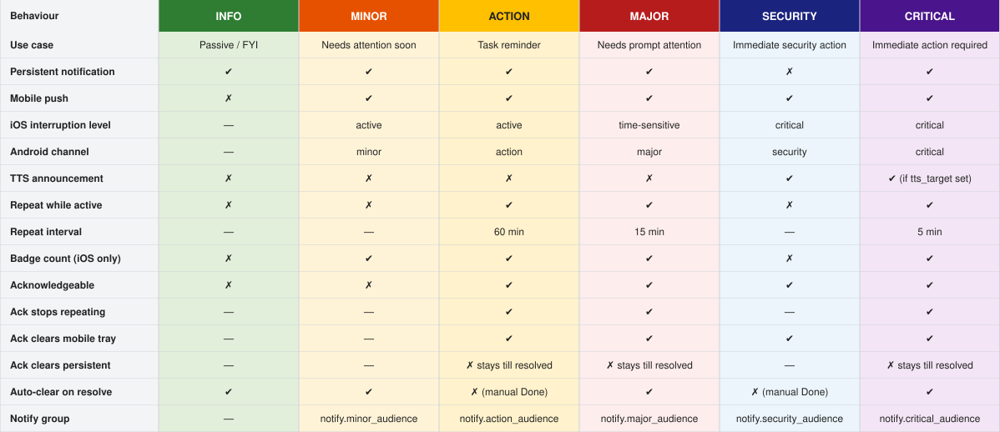

# Home Assistant Alert & Notification Framework

A replacement for the Home Assistant `alert:` integration. Alerts are defined with a template blueprint, and a small set of shared scripts and automations provide severity-based notifications, repeats, acknowledgement, suppression, and badge sync for every alert you define.

> **Status:** working on a clean Home Assistant instance. A custom integration with its own entity type is the long-term goal; this YAML implementation is the reference for it. Android support is partial; see [Platform notes](docs/design-reference.md#platform-notes-ios-and-android).

## Installing

Follow [INSTALL.md](INSTALL.md). It is a step-by-step manual install, with `curl` commands for each file.

## Contents

- [Overview](#overview)
- [Architecture](#architecture)
- [Severity levels](#severity-levels)
- [More documentation](#more-documentation)

## Overview

Each alert is a template binary sensor created from a blueprint, which enforces a consistent set of attributes (severity, title, message, tag, status helper and so on). Everything else (notifications, repeats, clearing, dashboard) reads those attributes, so adding an alert never means writing new automations.

Key design principles:

- Alert state and metadata live in template binary sensors, which are the single source of truth for all framework components.
- Template binary sensors are created from a blueprint that enforces a consistent attribute schema.
- `binary_sensor.automated_alert_sensors` is a UI-created group and is the registry of all alert sensors.
- No device references in scripts or automations. Audiences are managed through notify groups.
- Six shared automations handle all alerts, however many are defined.
- The `alert:` integration is not used.

What it gives you:

- Six severities (info, minor, action, major, security, critical) with different channels, interruption levels and repeat intervals.
- Acknowledge button on notifications, plus up to two custom action buttons per alert.
- Suppression when someone is home (the "silencer"), per alert.
- `skip_first`, to delay the first notification until the first repeat.
- `not_home_severity`, to raise or lower an alert's severity when nobody is home.
- Startup gating, so a Home Assistant restart doesn't produce false alerts.
- App badge count sync on iOS.
- An example dashboard card with severity colours, message and status.

## Architecture

| Component | What it does | Implementation | File |
|---|---|---|---|
| Alert binary sensor | Source of truth for alert state. Carries all metadata as attributes, including severity, title, message, tag, status_helper, skip_first, not_home_severity, is_suppressible and trigger_entity. | Template blueprint instance. Entity ID derived from the tag. A restart is needed after blueprint file changes. | `template-sensors/binary-sensor-blueprint_alerts.yaml` |
| `alert_binary_sensor_blueprint` | Enforces a consistent attribute schema. Generates the entity ID and name from the tag. Only `trigger_entity` is used in the state template. | Template domain blueprint, instantiated with `use_blueprint`. | `blueprints/template/mark1foley/` |
| `binary_sensor.automated_alert_sensors` | Registry of all alert binary sensors, used by all framework automations. | UI-created binary sensor group helper. | Settings > Helpers |
| `script.alert_notify` | Central routing. Dispatches to persistent notification, mobile push and TTS based on severity. Sets the status helper to `notified` (`idle` for security). | Reads severity to choose channels, priority levels and action buttons. | `alert_notify_script.yaml` (in `scripts.yaml`) |
| `script.alert_clear` | Dismisses the persistent notification and clears the mobile tray. Sets the status helper to `idle` or `acknowledged`. | Called by the State Change and Acknowledge automations. | `alert_clear_script.yaml` (in `scripts.yaml`) |
| Alert Framework: State Change | Triggered by `sensor.automated_alert_active_count`. Handles activate (notify, skip or suppress) and resolve (clear). Computes the effective severity from `not_home_severity`. | Queued mode. Checks `startup_complete`, the suppressor and `skip_first`. | `automations.yaml` |
| Alert Framework: Repeat | Re-notifies active alerts. Triggered every 5 minutes and when `binary_sensor.automated_alert_home` changes. Handles suppressed-state transitions and `not_home_severity` changes. | Action 60 min, major 15 min, critical 5 min. Minor and security only on suppression recovery or a home change. | `automations.yaml` |
| Alert Framework: Acknowledge | Handles notification button presses (`ACK_<TAG>`, `ACTION1_<TAG>`, `ACTION2_<TAG>`). | Listens for `mobile_app_notification_action` events. | `automations.yaml` |
| Alert Framework: Badge Sync | Silently updates the badge count on active-count change and at startup. iOS only. | State trigger on `sensor.automated_alert_active_count`. Sends to `notify.badge_audience`. | `automations.yaml` |
| Alert Framework: Startup | Turns off `startup_complete`, waits 2 minutes, re-notifies active alerts, then turns it back on. | Prevents false alerts on restart. | `automations.yaml` |
| Alert Framework: Periodic Badge Sync | Resyncs the badge count every 10 minutes. iOS only. | `time_pattern` trigger every 10 minutes. | `automations.yaml` |
| `sensor.automated_alert_active_count` | Drives the app badge count. Excludes security alerts. | Template sensor counting group members that are `on`. Created as a UI helper (YAML alternative: `alert_counter_sensor.yaml`). | Settings > Helpers |
| Notify groups | Audience management per severity. | `notify.minor_audience`, `notify.action_audience`, `notify.major_audience`, `notify.security_audience`, `notify.critical_audience` and `notify.badge_audience` (iOS devices only). | `alert_notify_groups.yaml` |

## Severity levels

Text version of the table

| Behaviour | INFO | MINOR | ACTION | MAJOR | SECURITY | CRITICAL |
|---|---|---|---|---|---|---|
| Use case | Passive / FYI | Needs attention soon | Task reminder | Needs prompt attention | Immediate security action | Immediate action required |
| Persistent notification | yes | yes | yes | yes | no | yes |
| Mobile push | no | yes | yes | yes | yes | yes |
| iOS interruption level | n/a | active | active | time-sensitive | critical | critical |
| Android channel | n/a | minor | action | major | security | critical |
| TTS announcement | no | no | no | no | yes | yes (if `tts_target` set) |
| Repeat while active | no | no | yes | yes | no | yes |
| Repeat interval | n/a | n/a | 60 min | 15 min | n/a | 5 min |
| Badge count (iOS only) | no | yes | yes | yes | no | yes |
| Acknowledgeable | no | no | yes | yes | yes | yes |
| Ack stops repeating | n/a | n/a | yes | yes | n/a | yes |
| Ack clears mobile tray | n/a | n/a | yes | yes | yes | yes |
| Ack clears persistent | n/a | n/a | no, stays until resolved | no, stays until resolved | n/a | no, stays until resolved |
| Auto-clear on resolve | yes | yes | no (manual Done) | yes | no (manual Done) | yes |
| Notify group | n/a | `notify.minor_audience` | `notify.action_audience` | `notify.major_audience` | `notify.security_audience` | `notify.critical_audience` |

Notes:

- Security severity uses `notify.security_audience`. Create that group in `alert_notify_groups.yaml` and restart Home Assistant before using security alerts.
- Repeat intervals are fixed per severity in the Repeat automation, not per alert. Acknowledging is the escape valve if a repeat is too aggressive in a given situation.
- Acknowledging an `action` alert is documented to clear the mobile tray, but the clear currently skips `notify.action_audience`. See [Known issues](docs/design-reference.md#known-issues-and-limitations).

## More documentation

The full design reference is in [docs/design-reference.md](docs/design-reference.md):

- [Adding a new alert](docs/design-reference.md#adding-a-new-alert)
- [Alert lifecycle](docs/design-reference.md#alert-lifecycle)
- [Status helper states](docs/design-reference.md#status-helper-states)
- [Alert binary sensor schema](docs/design-reference.md#alert-binary-sensor-schema)
- [Presence-based severity](docs/design-reference.md#presence-based-severity)
- [Silencer (suppressor)](docs/design-reference.md#silencer-suppressor)
- [Complex alert triggers](docs/design-reference.md#complex-alert-triggers)
- [Acknowledgement](docs/design-reference.md#acknowledgement)
- [Custom action buttons](docs/design-reference.md#custom-action-buttons)
- [Badge count](docs/design-reference.md#badge-count)
- [Platform notes (iOS and Android)](docs/design-reference.md#platform-notes-ios-and-android)
- [Framework constants](docs/design-reference.md#framework-constants)
- [Example dashboard card](docs/design-reference.md#example-dashboard-card)
- [Known issues and limitations](docs/design-reference.md#known-issues-and-limitations)
- [Future enhancements](docs/design-reference.md#future-enhancements)
- [File structure](docs/design-reference.md#file-structure)
